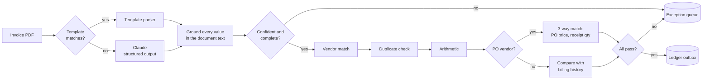
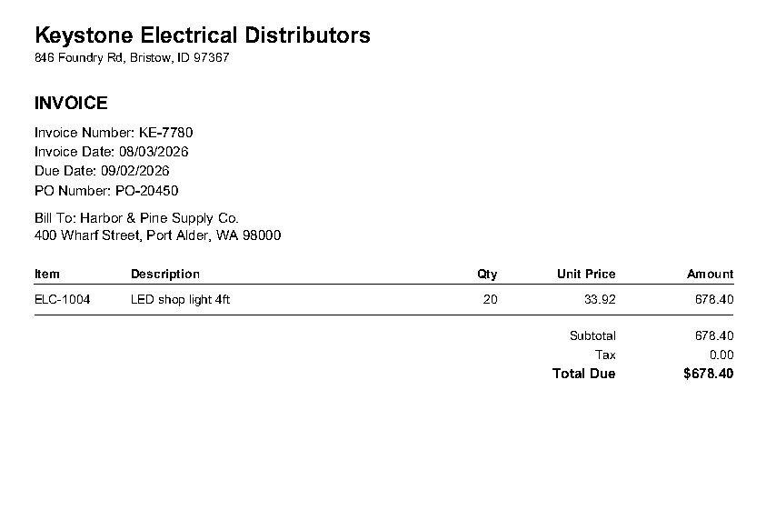
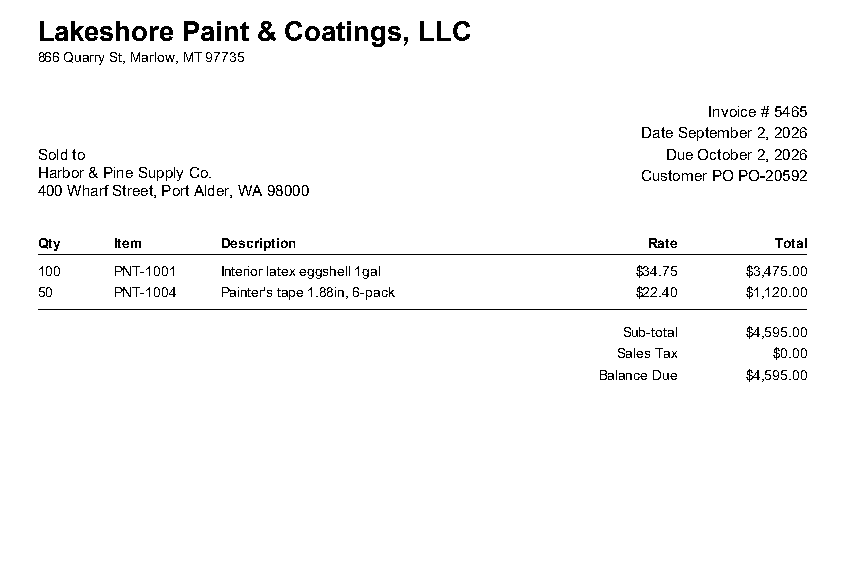
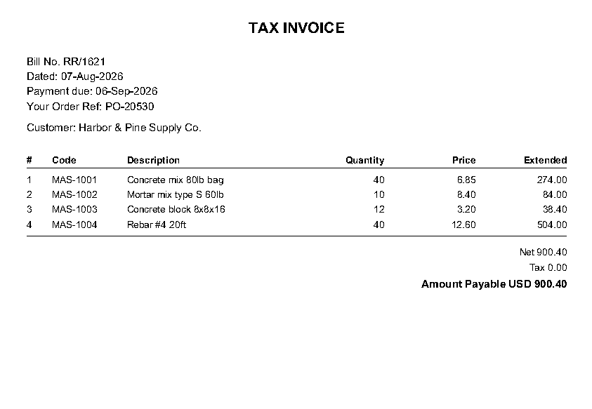
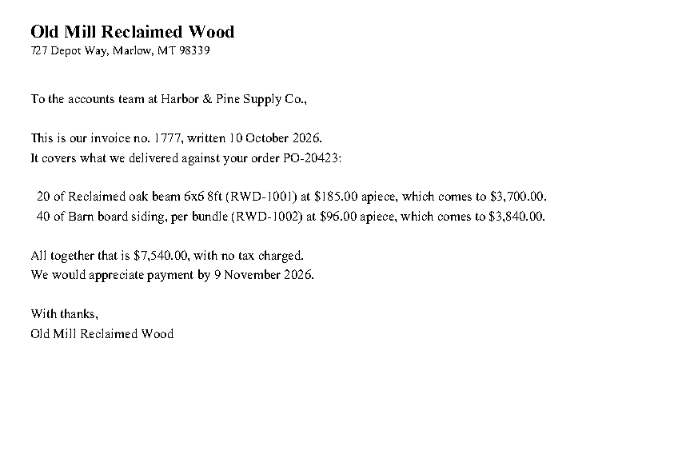

# Invoice Extractor

Reads supplier invoices, checks each one against the purchase order and the
receiving record, and either queues it for payment or sends it to the person
who can fix it, with the reason attached.

It runs end to end on synthetic data with one command and no API key.

```bash
pip install -e ".[llm,dev]"
invoice-extractor demo
```

## The problem

An accounts-payable clerk does the same four things to every invoice: read
it, find the purchase order, check that the price and quantity match what was
ordered and received, and key it into the ledger. Most invoices are fine, so
most of that time is spent confirming that nothing is wrong. The ones that are
wrong (a price above the PO, a quantity that never arrived, the same invoice
sent twice) are where the money is, and they are easy to miss in the volume.

The goal is not to automate AP. It is to take the invoices that need no
judgement off the clerk's desk, and to hand over the rest already diagnosed.

## What happens on the sample data

`invoice-extractor demo` generates 120 documents from 16 invented suppliers,
with a known right answer for each, and scores the run against it.

| | Templates only | Templates + Claude |
|---|---|---|
| Bad invoices queued for payment | **0** | **0** |
| Invoices paid with no human touch | 54.8% (63 of 115) | 61.7% (71 of 115) |
| Most that could have been, given the data | 61.7% | 61.7% |
| Good invoices sent to a human unnecessarily | 8 | 0 |
| Problem invoices stopped | 44, worth $110,699 | 44, worth $110,699 |
| Exceptions with the right queue and reason | 44 of 44 | 44 of 44 |

Full reports: [templates only](docs/EVAL_REPORT.md), [with Claude](docs/EVAL_REPORT_LLM.md).

**How to read these numbers.** The data is synthetic and the template parsers
were written for these layouts, so their 100% field accuracy shows the
plumbing works and nothing more. Real documents would score lower. What the
run does demonstrate is the decision logic: across every seeded problem, none
reached the payment queue, and each landed with the team that owns it.

The 8 unnecessary reviews in the first column are invoices written as a
letter rather than a form. No template reads them, so without a model they go
to a person. With `--llm` they go to Claude Opus 5.5, which read all 8
correctly on every field in a live run, and all 8 then cleared the same
checks as any other invoice. Eight clean, born-digital letters is a small and
easy sample. It shows the fallback path works end to end, not how the model
would do on scans or handwriting.

## How it works



Four supplier layouts are generated, because a real inbox is never one template:

| Classic | Modern | Ledger | Letter |
|---|---|---|---|
|  |  |  |  |

## What it catches

| Exception | Goes to | What it means |
|---|---|---|
| `price_variance` | purchasing | Unit price above the PO by more than tolerance. The message states the overcharge. |
| `qty_over_receipt` | receiving | Billed for more than has been received and not already billed. |
| `duplicate` | AP review (held) | Same file, or same invoice number from the same vendor. |
| `missing_po`, `po_not_found`, `po_vendor_mismatch`, `item_not_on_po` | purchasing | The invoice cannot be tied to an order. |
| `math_error` | AP review | The lines, tax and total disagree with each other. |
| `amount_anomaly`, `no_history` | accounting | A non-PO bill well outside what this vendor usually charges, or too little history to tell. |
| `vendor_unknown` | vendor onboarding | The name does not match an active vendor closely enough. |
| `low_confidence`, `incomplete`, `extraction_failed` | AP review | The document was not read well enough to act on. |

```
$ invoice-extractor queue

== purchasing ==
  [price_variance] doc_0016.pdf  Keystone Electrical Distributors  #KE-7780  $678.40
      ELC-1004 billed at 33.92, PO price 32.00 (+6.0%, tolerance 2.0%), overcharge 38.40
```

One case worth calling out. A vendor resends an invoice with a new number, say
`4417` becomes `4417-A`. A duplicate check on the invoice number passes it.
Here it is caught anyway, because the first invoice consumed the received
quantity on the PO and there is nothing left to bill against
(`test_renumbered_resend_is_caught_because_the_receipt_is_already_billed`).

## Design decisions

**The model reads. Code decides.** Claude is used for one thing: turning a
document no template recognises into the same typed record a template would
produce. Whether an invoice is paid is decided by arithmetic against
thresholds in [`tolerances.json`](src/invoice_extractor/tolerances.json), and
every comparison is stored. A model error can cause a review. It cannot cause
a payment.

**Confidence is checked, not self-reported.** The model is never asked how
sure it is. Each extracted value is looked up in the PDF's own text layer. An
invoice number or total that does not appear in the source scores low and the
document goes to a person. A scan with no text layer cannot be checked this
way, so it is always reviewed.

**The two kinds of mistake are not equal.** Reviewing a good invoice costs
minutes. Paying a bad one costs the invoice. The evaluation reports them
separately, CI fails on a single false auto-pass, and the touchless rate is
only ever quoted next to that count.

**Refuse rather than guess.** A template that does not recognise a layout
returns nothing. A vendor name that is only a rough match is treated as
unknown, since a look-alike vendor is a known fraud route. An expense vendor
with too little history is not auto-passed. A model saying "this is not an
invoice" is not enough to discard a document, because a wrongly discarded
bill is the one error nobody would ever review.

**Nothing writes to the ledger directly.** An approved invoice becomes a row
in `ledger_outbox` with a unique idempotency key. A separate connector would
drain it. A rerun or a retry cannot post the same bill twice because the
database will not accept the second row.

**Templates first, because they are free.** In this data 93% of documents are
read by a parser at no cost and with repeatable output. The model handles the
remainder. At list price a one-page invoice through Claude Opus 5.5 should
cost on the order of a cent or two; that is an estimate from token prices,
not a measurement.

## Data model

SQLite, so there is nothing to set up. Schema: [`schema.sql`](src/invoice_extractor/schema.sql).

| Table | Holds |
|---|---|
| `vendors`, `vendor_alias` | Vendor master, and the names a vendor is known by |
| `purchase_orders`, `po_lines` | Ordered, received and already-billed quantity per line: the three legs of the match |
| `bill_history` | Past bills for non-PO vendors |
| `invoices`, `invoice_lines` | Each document's extracted fields and current state |
| `extractions` | Raw engine output and per-field confidence, kept so a decision can be replayed |
| `validations` | One row per check per invoice, pass or fail |
| `exceptions` | The human work queue |
| `ledger_outbox` | Bills approved for posting |
| `audit_log` | Every state change, who made it, and why |

## Using the Claude engine

```bash
export ANTHROPIC_API_KEY=...
invoice-extractor run --llm
invoice-extractor eval
```

Only documents that no template matches are sent. The request uses structured
outputs, so the response is validated against the schema by the API. See
[`extraction/llm.py`](src/invoice_extractor/extraction/llm.py). The model
defaults to `claude-opus-5-5` and can be changed with `INVOICE_EXTRACTOR_MODEL`.

## Commands

| | |
|---|---|
| `invoice-extractor generate --n 120 --seed 7` | Write PDFs, master data and ground truth to `data/` |
| `invoice-extractor run [--llm] [-v]` | Process every PDF into `data/ap.db` |
| `invoice-extractor eval [--report FILE]` | Score the run. Exits 1 if any bad invoice auto-passed |
| `invoice-extractor queue` | Print open exceptions by team |
| `invoice-extractor demo` | generate, run, eval |

```bash
pytest -q    # 40 tests, no network
```

## Layout

```
src/invoice_extractor/
  synth/          synthetic suppliers, POs, receipts, PDFs, ground truth
  extraction/     rules.py (templates + grounding), llm.py (Claude), composite.py
  vendor.py       printed name -> vendor master
  validation.py   arithmetic, 3-way match, expense history
  pipeline.py     orchestration, decision, persistence
  evals.py        scoring against ground truth
  schema.sql      state store
  tolerances.json every threshold and queue assignment
tests/
docs/EVAL_REPORT.md
```

## Limits

- All data is synthetic. Nothing here has been run on real invoices.
- Clean, born-digital PDFs only. No scans, no multi-page invoices, no credit
  memos, no multi-currency, no freight or tax allocation.
- The Claude path has been run live on 8 documents only. Its cost was not measured.
- The grounding check is a substring match on the text layer. It catches an
  invented value. It would not catch a real value read into the wrong field.
- No review UI. The queue is a table and a CLI command.
- Each line is matched to the PO by item code. Suppliers who use their own
  part numbers would need a cross-reference table.

## Taking this to a real AP team

1. **Run in shadow.** Process the live inbox, post nothing, and compare the
   pipeline's decisions with what the clerks actually did for a few weeks.
   That comparison is the ground truth this repo has to synthesise.
2. **Set tolerances with the controller**, not in code. They are a statement
   of risk appetite and belong to finance.
3. **Turn on auto-pass one vendor at a time**, starting with the
   highest-volume, cleanest suppliers, and watch the false auto-pass count.
4. **Add templates where the volume is**, and let the model carry the tail.

## Background

I built and run an AP automation system at work that processes invoices for
several related companies. This project is a from-scratch, single-company
reduction of the same ideas on invented data, written so the design can be
read in an afternoon. It shares no code, data, vendors or documents with that
system.

## License

Apache 2.0
